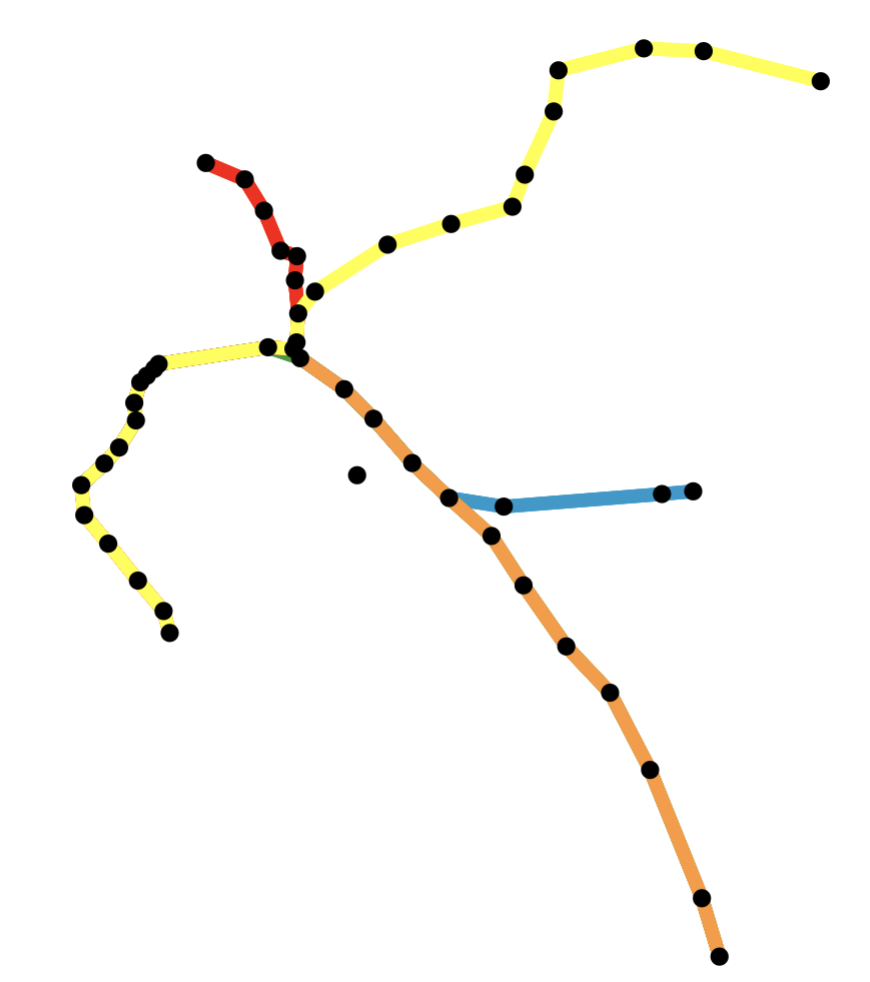

### R Packages II

Each of the following questions refer to the `kknn` package (<https://github.com/KlausVigo/kknn>) that we'll be using for predictive modeling.

@. What is the author's one sentence description of this package?

@. Which data sets are stored in this package?

@. Unlike most packages, you've used, you can't just type the name of a data set to see it (try it with `glass`). Instead you first have to use `data(glass)` to specifically load that data set. What is the name this property of a package? Does it exist in the DESCRIPTION file?

@. What is the name of the file in the package that is edited to created the help files for these data sets?

* * *

Return to the tiny package that you made called `greetr`.

@. Add the following tibble to the your package as a data set called `greetings`.

```{r}
library(tibble)
greetings <- tibble(
  greeting = c("Hello", "你好", "Hola", "Hei", "السلام علیکم"),
  language = c("English", "Chinese", "Spanish", "Norwegian", "Urdu")
)
```

@. Document this data set using `roxygen2` so that when a user types `?greetings` at the console they see a description of the data set, its format (the columns and their values), and its source (you can cite STAT 133). Please transcribe your documentation below.

@. Add documentation for your previous function called `hello()`. Be sure to include a description, the arguments, the output, and an example of its use. Please transcribe your documentation below.

@. One last item: bump your version number up by a small increment (say from 0.1.0 to 0.1.1) in the `DESCRIPTION` file. Write that single new line from your DESCRIPTION file below.

### Prediction II

Start by piecing together the code cells from the slides that use `tidymodels` to predict the `price` of diamonds using the value of `carat`. Put them into an .r script or Quarto document.

The following exercises have you investigate the different components of the code and make variations.

@. Run all of the code and inspect the final data frame. As measured by RMSE (Root Mean Squared Error), which of the two models has better performance on the test set?

@. Modify the code to add a third model to the mix: a KNN model with 50 instead of 15 neighbors. As measured by RSME, how does its predictive performance on the test set compare to the original two models?

@. What is the purpose of the `initial_split()` function? What is the type of the R object that it creates? What is the first element in that object and what does it represent?

@. What does the `training` function do? What is the type of the R object that it creates?

@. To understand the effect of the different steps of the data preparation recipe, make a duplicate of that pipeline and change the name of the result to `transformed`. Add two more functions to the pipeline: `prep()` and `bake()`[^bake]. Each beyond the piped recipe object, each one takes a data frame as an argument: use the training data.

    Compare `transformed_train` to `diamonds_train`. What changes have been made to the data as a result of this recipe?

[^bake]: The authors of `recipes` went all in on the baking metaphor.

@. Add two additional predictors to the recipe: `depth` and `table`[^form]. What do these variables represent about diamonds?

[^form]: In R's formula interface, you add additional predictors adding them to the right side: .e.g `y ~ x1 + x2`.

@. Rerun your original three models with this modified recipe. How does the predictive performance of each model on the test set compare?

### Classification

Start by piecing together the code cells from the slides that use `tidymodels` to predict the `species` (Gentoo or Adelie) of penguins using the value of `body_mass_g`. Put them into an .r script or Quarto document.

The following exercises have you investigate the different components of the code and make variations.

@. To build an understanding of the four metrics used to evaluate model performance, write four `dplyr` (`filter()`, `summarize()`, `mutate()`, etc.) pipelines to calculate each metric manually from `ad_gen_preds`. Alongside each of the pipelines, write the English interpretation of each (e.g. "the proportion of ___ penguins that the model predicted to be ____"). Check your results against the values in `all_metrics`.

@. Using the model that performed the *worst*, build a plot to understand where it made the errors. This should be a scatterplot with the predictor along the x-axis, the species along the y-axis, and points colored by whether it is a true positive, true negative, false positive, or false negative.

@. Add two additional predictors to the recipe: `island` and `bill_length_mm`. Also add a third step: `step_dummy(all_nominal_predictors())`. What are the different values that `island` can take?

@. Repeat the prep and bake phases as in the last problem set to get a glimpse of what the training data would look like when all of the steps are applied. What happened to the `island` column?

@. Rerun your original three models with this modified recipe. How does the predictive performance of each model on the test set compare?

* * *

@. Install the `kernlab` package and read the help file for `data(spam)`. What is the natural response variable in this dataset? What do each of the predictors represent?

@. Using the `spam` dataset, create a classification model to predict whether an email is spam or not spam. You may use whichever predictors you like and any model class (with any parameters). Use a 70/30 train/test split and evaluate the model using the same four metrics as in the penguin example. What is the highest you were able to get your test accuracy?

### APIs I

Revisit the homepage for the BART Legacy API discussed in Lecture.

<https://www.bart.gov/schedules/developers/api>

@. What is the public key that can be used to access data through the legacy API?

* * *

Next visit the documention site: <https://api.bart.gov/docs/overview/index.aspx>. Note that each category of data has its own endpoint / base URL, and all takes a similar format (e.g. for estimated departure data use <https://api.bart.gov/api/etd.aspx>.)

@. Provide the URL that will query the API for a list of all BART stations in JSON format.

@. Provide the corresponding shell/terminal command.

@. Provide the corresponding R code that will perform the query and parse the JSON response into an R list object.

@. Subset the list to to return a data frame that contains the station abbreviation, name, latitude, longitude, address, city, county, state, and zipcode for each station. Which county has the greatest number of stations?

* * *

@. Provide the URL that will query the API for estimated departure times (ETDs) from the Downtown Berkeley Station in JSON format.

@. Provide the corresponding R code that will perform the query and parse the JSON response into an R list object.

@. Extract the elemented called `root` and then the `station` element within it. View the object using the data viewer. What type of object is it an what are it's dimensions?

@. Use the `unnest()` function from the `tidyr` package to expand the `etd` list-column. What are the dimensions of the resulting data frame?

@. Use `unnest()` again to expand the `estimate` list-column. What are the dimensions of the resulting data frame?

@. How long (in minutes) is the shortest estimated wait time for a train departing from Downtown Berkeley Station? Which destination does this train go to? For reference, what time is it now?

* * *

@. Query the BSA (BART System Advisories) endpoint to retrieve the latest system advisory information. You're welcome to use any method: web browser, command line, or R. What are the different bits of information that they provide through this endpoint?

@. *Optional Challenge*: Use the data provided by the BART API to construct a map of the BART system showing the locations of all stations. You could make it interactive with leaflet or static like the one below.

{fig-align="center" width="400px"}
